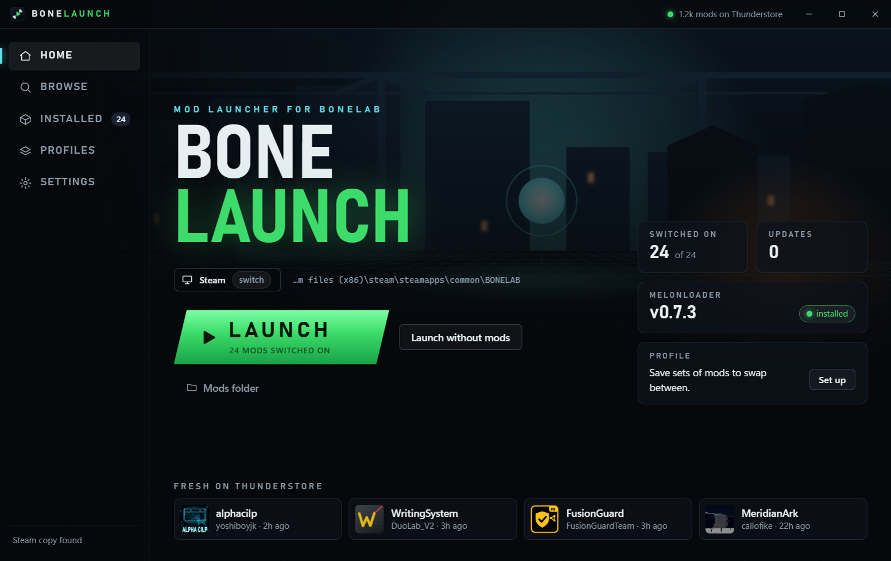
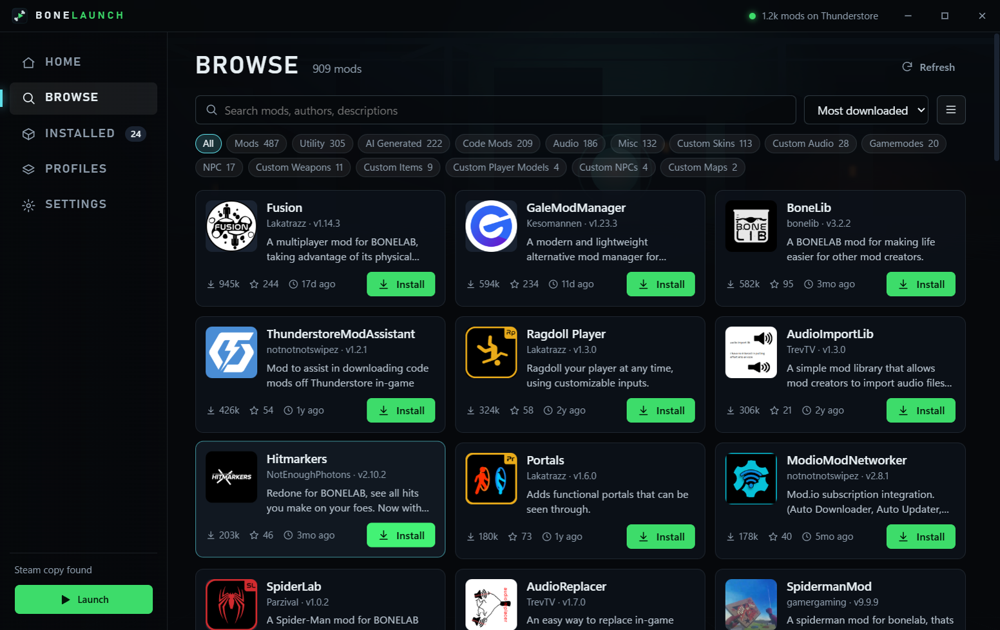

# BoneLaunch

A mod launcher for BONELAB on Windows, with Thunderstore built in.



## What it does

- **Finds your game.** Detects whether you play on Steam or Meta (Oculus). If you have both, you can switch between them.
- **Browse Thunderstore.** Search, sort and filter every BONELAB mod without leaving the app.
- **One-click install.** Mods go into the right folders for you, along with any mods they need.
- **MelonLoader handled.** BoneLaunch spots when the mod loader is missing and installs it. You can pick the version.
- **Manage what you have.** Switch mods on and off, update them, remove them. Mods you added by hand show up too.
- **Profiles.** Save sets of switched-on mods and swap between them. Share a profile with a friend as a code.
- **Launch.** A big green button, plus "Launch without mods" for when something breaks.
- **Make it yours.** Accent colors, your own background picture, fade and blur.



## Download

Get the newest version from the [Releases page](https://github.com/DuoL4B/BoneLaunch/releases/latest), or visit the [website](https://duol4b.github.io/BoneLaunch/):

- `BoneLaunch-Setup-x.y.z.exe` installs it like a normal app.
- `BoneLaunch-Portable-x.y.z.exe` runs without installing and keeps its data in a `BoneLaunchData` folder next to itself.

The files are not code-signed, so Windows SmartScreen may warn you the first time. Choose **More info**, then **Run anyway**.

## Good to know

- Close BONELAB before installing, removing or switching mods. Windows locks mod files while the game is running.
- The first launch after installing MelonLoader takes a few minutes while it sets itself up.
- Switching a mod off renames its `.dll` to `.dll.disabled`. Nothing is deleted.
- Removing a mod you added by hand sends it to the Recycle Bin.
- NSFW and deprecated mods are hidden in Browse by default. You can show them in Settings.

## Build it yourself

You need [Node.js](https://nodejs.org) 20 or newer.

```bash
npm install
npm run assets
npm start
```

To make the installer and the portable exe (they land in `dist/`):

```bash
npm run dist
```

## How it works

- `src/main` is the part with access to your PC: finding the game, talking to Thunderstore, unpacking mods.
- `src/renderer` is the window you see, in plain HTML, CSS and JavaScript.
- Mod zips are unpacked by folder: `Mods`, `Plugins`, `UserLibs`, `UserData` and `MelonLoader` go to the same folder in the game. Loose DLLs go to `Mods`.
- BoneLaunch only downloads from `thunderstore.io`, and uses no accounts or API keys.

## Disclaimer

BoneLaunch is a fan-made tool. It is not affiliated with or endorsed by Stress Level Zero, Thunderstore, Valve or Meta. BONELAB is a trademark of Stress Level Zero. Mods are made by their own authors; use them at your own risk.

## License

[MIT](LICENSE)
